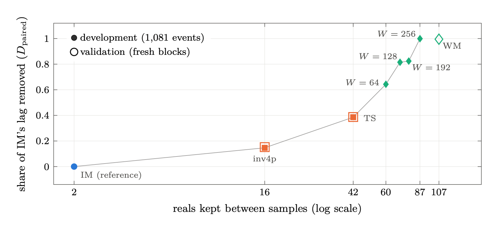

# SDTS: bounded-memory fault monitors, measured against an exact oracle

SDTS (Software-Defined Temporal Sensing) asks how much of a sensor's history a fault monitor has to keep in order to
detect faults soundly, that is, without ever raising an alarm on a healthy record, when its memory is bounded.

A set-membership fault detector raises an alarm when no admissible explanation of the sensor record exists. The exact
detector keeps a set whose description grows with the record. A monitor on a microcontroller can only keep a bounded
outer approximation of that set, so it may detect later. This repository measures how much later. A certified linear
program over the full history gives the exact detection time of every run it can certify, and each bounded monitor is
scored against that time under the same assumptions. The plant is a two-node thermal model with one temperature
sensor, a known heat input and an unknown ambient temperature.

> Can Koç, *How much of the record does a sound fault monitor need? Bounded-memory set-membership detection of sensor
> faults, measured against the exact oracle*, preprint, 2026. The preprint link will be added here.

## Results

*Each monitor's share of the interval monitor's detection lag removed, against the reals it keeps between samples (Figure 2 of the paper; filled markers: development data, open markers: fresh validation blocks).*

The numbers are from the paper; each one is traced to a dated record in `experiments/v3/`.

- **Template monitor.** A template polyhedron with 42 supports whose LP bases are computed offline, so it needs no
  solver at run time. It is proved sound and never later than the interval monitor it extends. On 9,600 fresh,
  preregistered runs it removed 38.7 % of the interval monitor's paired detection lag. Its C build on an ESP32 gave
  the PC build's alarm flag and a 16-byte hash of its full state after every one of 5.04 million development samples.
- **Window monitor.** An LP over the last 256 samples whose base is updated by a smoothing rule. Every alarm carries a
  weak-duality certificate, and an LP the solver cannot solve falls back to an analytic outer bound. On a second fresh
  block of 9,600 runs it removed 99.5 % of the interval monitor's lag with no missed certified event, and all 7,258
  alarms were certified.
- **Baselines.** Five baselines, given the same prior and tuned before the run, all lagged at their memory budget. The
  best set-based one, a constrained zonotope storing 203 reals, had 1.8 times the interval monitor's lag.
- **A limit no monitor can beat.** No memory budget can certify the error of a sensor drift that an admissible ambient
  path reproduces.

## What went wrong

The failures are part of the result, and the paper has a section on them. Two that a reader of the code meets first:

- The first validation of the window monitor failed: one LP the solver could not solve became an uncertified alarm.
  The failure, its diagnosis and the sound fallback that replaced it are in the paper and in `experiments/v3/`.
- The frozen Python template is sound only for noise at least 4.85e-13 °C inside the bound. A constructed healthy
  record makes it flag (`experiments/v3/RECORD-2026-11-22-review2.md`, `experiments/v3/diag/s_gap_witness.py`). The
  fix is not in the frozen code.

Reproductions that disagree with a reported number are welcome; please write (address below).

## Check it yourself

Each validation is fixed by a freeze document, a manifest and an approval commit. The runners check every file of the
manifest by sha256 and refuse to start outside the locked environment (CPython 3.12.13, numpy 2.5.5, scipy 1.18.1).
Scoring the stored rows at each approval commit gives the recorded `scores.json` byte for byte.
`experiments/v3/REPRODUCE.md` gives the commands for that, for regenerating a block, for the wider-box study and for
the healthy-record witness.

## Where things are

| Path | Contents |
|---|---|
| `paper/preprint/` | the paper (`main.tex`, `refs.bib`, figures) and `make_arxiv.sh`, which builds the upload archive |
| `paper/figures/` | the script that makes the figures' data, and the README's figure with the script that builds it |
| `experiments/v3/` | the monitors, the three freeze documents, the run and scoring scripts, the dated records (`RECORD-*.md`) and `REPRODUCE.md` |
| `experiments/v3/diag/` | diagnostic studies and checks that the records cite |
| `results/v3/` | the stored rows, manifests and summaries of each run |
| `experiments/generators/`, `machine/`, `oracle/`, `baselines/`, `specs/`, `final/`, `records/` | the simulator, the oracle and SDTS's first thermal study (v2), which v3 builds on |
| `tests/`, `env/` | tests; the environment lock and its check |
| `archive/pre-reset-2026-08-16/` | DMREDA, the closed earlier line, as it stood at the reset, negative results included |
| `docs/` | the research charter and validation rules written when the project was reset on 16 August 2026 |

## Project history

- **The name.** SDTS stands for Software-Defined Temporal Sensing. It is unrelated to the USGS Spatial Data Transfer
  Standard, which has the same acronym. Until 22 November 2026 this repository was named `dmreda-sdts-research`.
- **Earlier lines.** DMREDA and MGDE are the author's earlier research lines on temporal state in embedded fault
  handling; both are closed. The repository was reset to SDTS on 16 August 2026. DMREDA's material from before the
  reset is kept byte for byte in `archive/pre-reset-2026-08-16/`, negative results included. MGDE is not in this
  repository.
- **A removed file.** `HANDOFF.md`, a working handoff of 17 November 2026 cited by
  `experiments/records/thermal_v2_cal_review/RECORD-2026-11-17.md`, is no longer at the tip; it is in the history at
  commit `7cad493e`.

## License

- Source code (`.py`, `.c`, `.h`, `.ino`, `.sh` and the other program files): Apache License 2.0, see `LICENSE` and
  `NOTICE`.
- The paper, figures, plans, records, notes and result data: Creative Commons Attribution 4.0 International
  (CC BY 4.0), https://creativecommons.org/licenses/by/4.0/.
- `archive/pre-reset-2026-08-16/` follows the same split.

## Citing

See `CITATION.cff` (GitHub shows it as "Cite this repository").

## Contact

Can Koç, cankoc.dev@proton.me: questions, reproductions, industrial use and collaboration.
